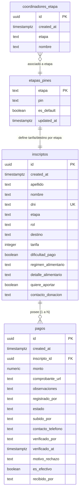
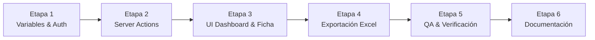

# Relevamiento Previo — Panel General de Campamentos CAMREVOC

**Fecha de relevamiento:** 15 de octubre de 2026  
**Estado:** Relevamiento técnico y diseño arquitectónico (sin cambios en código funcional)  
**Proyecto Supabase asociado:** `camrevoc-campa`  
**Ruta propuesta:** `/campamento/admin-general`

---

## 1. Arquitectura Actual del Módulo Campamentos

### 1.1 Rutas y Componentes Existentes

El módulo Campamentos de Verano 2027 opera bajo el subdirectorio `src/app/campamento/` con 4 rutas activas:

| Ruta | Acceso | Tipo de Componente | Propósito | Componentes / Server Actions Clave |
|---|---|---|---|---|
| `/campamento/inscripcion` | Público | Server Component + Client Form | Formulario de confirmación de asistencia, asignación automática de destino y tarifa según etapa, captura de rol, régimen alimentario y donaciones. | • `InscripcionForm.tsx`<br>• `InfoCampamentoCard.tsx`<br>• Server Action: `inscribirParticipante` (`src/app/campamento/actions/inscripcion.ts`) |
| `/campamento/pagos` | Público | Server Component + Client Form | Portal de autogestión para familias: consulta de saldo y pagos rechazados mediante DNI, desglose de transferencias compartidas entre hermanos y subida de comprobantes. | • `FamiliaPagosForm.tsx`<br>• Server Actions: `buscarInscriptoPorDni`, `subirPagoFamilia` (`src/app/campamento/actions/familia-pagos.ts`) |
| `/campamento/coordinacion` | Público / Login | Server Component con redirección | Portal de acceso para coordinadores de etapa mediante selección de etapa, auto-registro de nombre y validación de PIN. | • `CoordinacionLoginForm.tsx`<br>• Server Action: `loginCoordinador`, `obtenerCoordinadoresEtapa` (`src/app/campamento/actions/coordinacion-auth.ts`) |
| `/campamento/etapa/[etapa]` | Protegido (Cookie de etapa) | Server Component dinámico (`force-dynamic`) | Dashboard de gestión operativa y auditoría exclusivo para la etapa activa en sesión: padrón, auditoría de pagos pendientes/rechazados, carga manual y cambio de PIN. | • `EtapaDashboard.tsx`<br>• `GestionPagosModal.tsx`<br>• `PagosPendientesSection.tsx`<br>• `PagosRechazadosSection.tsx`<br>• `CambiarPinModal.tsx`<br>• Server Actions: `getInscriptosEtapa`, `aprobarPagoCampamento`, `observarPagoCampamento`, `registrarPagoCampamento`, `actualizarPagoCampamento` (`src/app/campamento/actions/coordinacion-pagos.ts`) |

### 1.2 Flujo de Datos y Runtime

- **Next.js 16 App Router con React 19:** Todas las mutaciones y lecturas privilegiadas se ejecutan a través de Server Actions (`"use server"`).
- **Aislamiento de Supabase:** La persistencia se realiza exclusivamente contra el proyecto `camrevoc-campa` a través de la función `createCampamentoClient()` (`src/lib/supabase/campamento.ts`). Este cliente utiliza la variable de servidor `CAMPAMENTO_SUPABASE_SERVICE_ROLE_KEY` y elude las políticas RLS. No existe cliente anónimo de navegador para este proyecto.
- **Almacenamiento de Archivos (Storage):** Los comprobantes de transferencias y recibos de pagos en efectivo se suben al bucket público `comprobantes-campa` a través de Server Actions en el backend (`subirPagoFamilia` o `registrarPagoCampamento`).
- **Control Perimetral:** A diferencia del módulo Pollos, las rutas de Campamentos **no** están interceptadas por `proxy.ts`. La autorización se valida a nivel de Server Component en `src/app/campamento/etapa/[etapa]/page.tsx` invocando `getCampaSession()`.

---

## 2. Modelo de Datos Real Verificado (`camrevoc-campa`)

A través de la inspección de código y consultas activas, se comprobó la estructura real de la base de datos de Campamentos:



### 2.1 Representación de los Campamentos y Etapas

1. **Dos Destinos Físicos:**
   - Se representan en la columna `destino` de la tabla `inscriptos` con los valores textuales `"Junín"` o `"Regina"`.
   - La asignación es determinística según la etapa del participante (regla universal definida en `src/config/campamento.ts`):
     - **Campamento Junín de los Andes:** 1ra, 2da, 3ra, 6ta y 7ma Etapa. Tarifa: **$550.000 ARS**. Fechas: 20 al 24 de enero 2027.
     - **Campamento Villa Regina:** 4ta y 5ta Etapa. Tarifa: **$200.000 ARS**. Fechas: 27 al 31 de enero 2027.
2. **Identificación de Etapas:**
   - En `inscriptos.etapa` se almacena como texto con formato `"1ra Etapa"`, `"2da Etapa"`, etc.
   - En `etapas_pines.etapa` y `coordinadores_etapa.etapa` se almacena como dígito textual (`"1"` a `"7"`).
   - En las consultas SQL de etapa se utiliza el filtro insensible `.ilike("etapa", `${etapaNum}%`)`.

### 2.2 Campos Personales de cada Inscripto

- **Datos de Identidad:** `apellido`, `nombre`, `dni` (numérico de 7 a 9 dígitos, único en toda la tabla).
- **Datos Organizativos:** `etapa`, `rol` (`CRVQUISTA`, `ANIMADOR`, `COORDINADOR`), `destino`, `tarifa`.
- **Datos Médicos y Nutricionales:** `regimen_alimentario` (`Omnívoro`, `Vegetariano`, `Celíaco`, `Vegano`, `Otros`) y `detalle_alimentario` (obligatorio si el régimen es `"Otros"`, nullable en los demás).
- **Acompañamiento y Donaciones:** `dificultad_pago` (booleano declarativo), `quiere_aportar` (booleano) y `contacto_donacion` (texto libre con teléfono/nombre).
- **Importante sobre Datos de Contacto:** La tabla `inscriptos` **no almacena teléfono ni correo electrónico personal** del participante. El único teléfono de contacto registrado se captura cuando la familia sube un comprobante en la tabla `pagos` (`pagos.contacto_telefono`).

---

## 3. Lógica Contable y de Pagos

### 3.1 Relación Inscriptos - Pagos
- Relación **1 a N** (`pagos.inscripto_id` con `ON DELETE CASCADE`).
- Un inscripto puede tener **cero, uno o múltiples pagos** asociados (pagos en cuotas mensuales sucesivas).
- En transferencias bancarias compartidas por 2 o más hermanos, el sistema inserta una fila en `pagos` por cada hermano, asignando el monto correspondiente a cada uno y vinculando el mismo archivo en `comprobante_url`.

### 3.2 Estados Individuales de un Pago (`pagos.estado`)

| Estado | Significado Contable | ¿Descuenta Saldo? | ¿Suma a Recaudación? | Origen habitual |
|---|---|---|---|---|
| **`PENDIENTE`** | Pago informado por la familia que espera verificación de comprobante. | **NO** | **NO** | Portal `/campamento/pagos` |
| **`APROBADO`** | Pago verificado y validado por coordinación (o ingresado directamente por coordinación). | **SÍ** | **SÍ** | Acción de coordinadores en dashboard |
| **`RECHAZADO`** | Comprobante desestimado (monto no acreditado, imagen ilegible). Requiere `motivo_rechazo`. | **NO** | **NO** | Acción de coordinadores con motivo explícito |

### 3.3 Estados Contables Calculados del Participante

No se guardan en la base de datos; se computan en memoria a partir de los pagos en estado `APROBADO`:
- **`PENDIENTE`:** `totalAbonado === 0`.
- **`PARCIAL`:** `totalAbonado > 0 && totalAbonado < tarifa`.
- **`PAGADO`:** `totalAbonado >= tarifa`.
- **Saldo adeudado:** `Math.max(0, tarifa - totalAbonado)`.

### 3.4 Modalidades de Pago y Auditoría
- **Transferencia Bancaria:** `es_efectivo === false`, comprobante bancario adjunto en Storage.
- **Efectivo en Mano:** `es_efectivo === true`, campo obligatorio `recibido_por` (quién cobró el dinero) y foto del recibo en papel en `comprobante_url`.
- **Auditoría:** Cada pago aprobado o rechazado conserva `verificado_por` (nombre del coordinador) y `verificado_at` (timestamp).

---

## 4. Relevamiento de Autenticación y Autorización

### 4.1 Mecanismo Actual en Campamentos (`/campamento/coordinacion`)
- Acceso por PIN de etapa (1 a 7).
- La sesión se almacena en la cookie `campa_etapa_session` serializada como JSON:
  `{ etapa: "1ra", etapaNum: "1", coordinador: "Nombre", esDefaultPin: boolean }`.
- **Límite actual:** Cada sesión está estrictamente ligada a una única etapa. Si el usuario intenta acceder a `/campamento/etapa/2` con una sesión de etapa 1, es redirigido forzosamente a su etapa correspondiente. No existe actualmente un rol ni sesión de coordinación global.

### 4.2 Mecanismos en otros Módulos y Patrón Recomendado
- En `src/app/convivencia/actions/admin-actions.ts` y `/convivencia/admin`:
  - Contraseña administrativa en variable de entorno (`CONVIVENCIA_ADMIN_PASSWORD` o `ADMIN_PASSWORD`).
  - Cookie HTTP-Only con **token derivado por HMAC-SHA256** (`buildSessionToken(password)`).
  - Validación en tiempo constante (`timingSafeEqual`) en el Server Component y en cada Server Action.
  - **Ventaja de este patrón:** No almacena contraseñas en texto plano ni strings predecibles; cambiar la contraseña en variables de entorno revoca de inmediato todas las sesiones activas; opera de forma desacoplada sin depender de `proxy.ts`.

---

## 5. Propuesta de Arquitectura para el Panel General

### 5.1 Nuevas Rutas
- **`/campamento/admin-general`**: Dashboard general consolidado (Server Component protegido).
- **`/campamento/admin-general/login`**: Formulario de ingreso mediante contraseña general de coordinación/tesorería.

### 5.2 Modelo de Acceso y Autorización
- **Solo Lectura:** El panel general tendrá fines de auditoría, control de tesorería y exportación. No incluirá botones de mutación (no aprobará pagos, no rechazará comprobantes ni creará inscriptos). Las modificaciones continúan bajo la órbita de los coordinadores de cada etapa en `/campamento/etapa/[etapa]`.
- **Credencial:** Variable de entorno `CAMPAMENTO_ADMIN_GENERAL_PASSWORD` (con fallback opcional a `ADMIN_PASSWORD`).
- **Sesión:** Cookie `campa_admin_general_session` con token criptográfico HMAC-SHA256 (`"campa-admin-general-v1"`), expiración de 8 a 12 horas, flags `httpOnly`, `sameSite: "lax"`, y `secure` en producción.

### 5.3 Flujo de Navegación y Vistas en la Interfaz

```
┌────────────────────────────────────────────────────────────────────────┐
│  Panel General de Campamentos 2027 (Junín & Regina)                   │
│  [Métricas Globales: Total Inscriptos | Recaudado | Pendiente | % Meta]│
├────────────────────────────────────────────────────────────────────────┤
│  Filtros:                                                              │
│  [Todos los Campamentos | Junín | Regina]                              │
│  [Todas las Etapas | 1ra | 2da | 3ra | 4ta | 5ta | 6ta | 7ma]          │
│  [Estados: Todos | Pagado | Parcial | Pendiente | Con Dificultad]      │
│  [Buscador: Nombre, Apellido o DNI...]       [📥 Exportar a Excel]     │
├────────────────────────────────────────────────────────────────────────┤
│  Tabla / Nómina Unificada:                                            │
│  • Apellido y Nombre  • DNI  • Etapa  • Destino  • Tarifa              │
│  • Abonado Aprobado   • Saldo  • Estado Pago  • Acciones [Ver Ficha]   │
└────────────────────────────────────────────────────────────────────────┘
```

1. **Métricas Consolidadas en Cabecera:**
   - Inscriptos totales (con desglose Junín vs. Regina).
   - Recaudación total acumulada (solo pagos aprobados).
   - Presupuesto proyectado al 100% de la tarifa.
   - Saldo global por cobrar.
   - Pagos pendientes de revisión en todo el sistema.
2. **Navegación y Filtros Cruzados:**
   - Selector de Destino: Ambos / Junín ($550k) / Regina ($200k).
   - Selector de Etapa: Todas / 1ra a 7ma.
   - Selector de Estado Contable: Todos / Al día (`PAGADO`) / Parcial / Sin pagos / Con dificultad económica declarada.
   - Buscador universal en vivo por apellido, nombre o DNI.
3. **Ficha Individual del Participante (Modal de Detalle):**
   - Resumen de inscripción: DNI, etapa, rol, destino, tarifa.
   - Situación nutricional y pastoral: régimen alimentario, observaciones de salud/alergias, intención de aporte.
   - Historial completo de pagos: tabla cronológica de todos los pagos registrados (aprobados, pendientes, rechazados), con indicación de modalidad (efectivo/transferencia), cobrador/auditor, motivo de rechazo si aplica y enlace al comprobante respaldatorio en Storage.

### 5.4 Exportación a Excel (.xlsx)

- **Librería a reutilizar:** `xlsx` (SheetJS), ya presente e integrada en el repositorio.
- **Server Action dedicada:** `exportarInscriptosCampamentoAction({ destino?, etapa?, estadoPago? })`.
- **Columnas a incluir:**
  1. `Apellido`
  2. `Nombre`
  3. `DNI` (formato celda tipo texto `'s'` y formato `'@'` para preservar ceros iniciales).
  4. `Etapa` (ej. "1ra Etapa").
  5. `Destino` ("Junín" o "Regina").
  6. `Rol` ("CRVQUISTA", "ANIMADOR", "COORDINADOR").
  7. `Tarifa Base` (numérico).
  8. `Total Abonado` (suma de aprobados).
  9. `Saldo Pendiente` (tarifa - abonado).
  10. `Estado Contable` ("PAGADO", "PARCIAL", "PENDIENTE").
  11. `Pagos en Revisión ($)` (suma de pagos con estado PENDIENTE).
  12. `Dificultad de Pago` ("Sí" / "No").
  13. `Régimen Alimentario` ("Omnívoro", "Celíaco", etc.).
  14. `Detalle Alimentario` (texto de alergias / restricciones).
  15. `Quiere Aportar` ("Sí" / "No").
  16. `Contacto Donación` (teléfono / nombre).
- **Orden:** Alfabético por `apellido` y luego por `nombre` (`localeCompare("es", { sensitivity: "base" })`).
- **Descarga:** Descarga directa en el navegador mediante Blob, con nombre paramétrico (ej. `campamentos-2027-inscriptos-general.xlsx`).

---

## 6. Seguridad y Protección de Datos

1. **Protección de la Contraseña Compartida:**
   - Se configurará `CAMPAMENTO_ADMIN_GENERAL_PASSWORD` en `.env.local` / variables del host.
   - El token de sesión será generado mediante HMAC-SHA256 con clave secreta y verificado con `timingSafeEqual`.
   - Se evitará el uso de valores booleanos o strings fijos en cookies.
2. **Protección en Consultas del Servidor:**
   - La Server Action de consulta general `obtenerInscriptosGeneralCampamento()` validará estrictamente la sesión administrativa general antes de invocar a Supabase.
   - No se expondrá ningún endpoint de API anónimo o ruta pública que devuelva la nómina consolidada.
3. **Protección de Archivos y Enlaces:**
   - Las URLs de comprobantes apuntan al bucket público `comprobantes-campa`; las rutas de los archivos contienen timestamps y nombres sanitizados.
   - Solo se presentarán los enlaces a comprobantes dentro de la ficha de auditoría protegida.
4. **Protección de Datos Médicos y Personales:**
   - Los datos médicos (alergias, régimen alimentario) y de vulnerabilidad económica (`dificultad_pago`) quedan resguardados bajo la sesión administrativa general y no son accesibles por participantes ni terceros.

---

## 7. Riesgos, Dudas y Discrepancias Detectadas

### 7.1 Discrepancias Documentales
- **Archivo `.agents/agents/campamentos.md`:** No existe en el árbol del repositorio. El relevamiento se basó en `AGENTS.md`, la documentación canónica en `docs/` y el código fuente real.
- **Archivo `docs/campamento-schema.sql`:** Como ya señala `docs/database.md`, este archivo es histórico y no refleja columnas activas como `es_efectivo`, `recibido_por`, ni los defaults reales de las Server Actions. El código fuente es la fuente de verdad.

### 7.2 Incertidumbres y Decisiones Necesarias antes de Implementar

1. **Datos de Contacto de los Participantes:**
   - *Hallazgo:* La tabla `inscriptos` no tiene campos de teléfono ni correo. El teléfono solo existe de forma opcional en `pagos.contacto_telefono`.
   - *Decisión requerida:* ¿El panel general y la exportación a Excel deben incluir el último teléfono informado en los pagos, o se mantiene el padrón estrictamente con los datos de `inscriptos`?
2. **Identificación de Grupos Familiares (Hermanos):**
   - *Hallazgo:* No existe una clave foránea ni tabla intermedia de "familias" en Campamentos. Los hermanos se identifican únicamente porque comparten la misma URL de comprobante en la tabla `pagos`.
   - *Decisión requerida:* ¿Es necesario que el panel agrupe o señale visualmente qué pagos corresponden a una misma transferencia bancaria compartida?
3. **Escala y Rendimiento de la Consulta:**
   - Con ~300 inscriptos y ~600 pagos estimados, una única consulta unificada en el servidor (`inscriptos` + `pagos`) transfiere menos de 500 KB de JSON.
   - Se puede cargar el conjunto completo en el cliente para ofrecer ordenamiento, búsqueda instantánea y filtros multidimensionales sin latencia de red.
4. **Coexistencia con el Panel de Etapa:**
   - La creación de `/campamento/admin-general` no debe alterar en absoluto la cookie `campa_etapa_session` ni las funciones de `/campamento/etapa/[etapa]`. Ambos paneles convivirán de forma independiente.

---

## 8. Plan de Implementación por Etapas (Propuesto)

Cuando se apruebe la implementación, se sugiere ejecutar el siguiente orden de trabajo:



### Etapa 1: Autenticación y Seguridad
- Definir la variable `CAMPAMENTO_ADMIN_GENERAL_PASSWORD`.
- Crear Server Action `src/app/campamento/actions/admin-general-auth.ts` con funciones de login, logout y verificación de sesión mediante HMAC-SHA256.
- Crear la página de login `/campamento/admin-general/login/page.tsx` con su formulario cliente.

### Etapa 2: Server Actions de Consulta General
- Crear `src/app/campamento/actions/admin-general-actions.ts`.
- Implementar la función `obtenerDatosAdminGeneral()`: consulta todos los `inscriptos` y todos los `pagos` de `camrevoc-campa`, calcula las métricas globales y arma la estructura `InscriptoConPagos[]`.

### Etapa 3: Página y Componentes del Dashboard
- Crear la página `/campamento/admin-general/page.tsx` (Server Component que valida sesión y obtiene datos iniciales).
- Crear el componente `src/components/campamento/admin-general/AdminGeneralDashboard.tsx`:
  - Barra de navegación con botón de cerrar sesión y enlace al Hub.
  - Tarjetas de métricas consolidadas (global, Junín, Regina).
  - Filtros interactivos por campamento, etapa y estado contable.
  - Buscador en tiempo real por texto (nombre, apellido, DNI).
  - Tabla de participantes con badges de estado y botón de apertura de ficha.
  - Modal de ficha individual con desglose completo de inscripción e historial de pagos.

### Etapa 4: Exportación a Excel
- Crear en `admin-general-actions.ts` la función `exportarCampamentoExcelAction()`.
- Utilizar `xlsx` para generar el libro de cálculo con las 16 columnas detalladas, DNI como texto (`t: 's'`, `z: '@'`) y orden alfabético.
- Integrar el botón «Exportar a Excel» en la interfaz del panel con feedback de progreso y descarga directa vía Blob.

### Etapa 5: Pruebas y Validación Técnica
- Ejecutar `npx tsc --noEmit`.
- Ejecutar `npm run lint`.
- Ejecutar `npm run build`.
- Validar preservación de ceros en DNIs y consistencia contable con datos de prueba.

### Etapa 6: Documentación Viva
- Actualizar `docs/campamentos/README.md`, `docs/campamentos/flujo.md`, `docs/campamentos/business-rules.md` y `docs/decisions.md` registrando la nueva ruta y su arquitectura.
